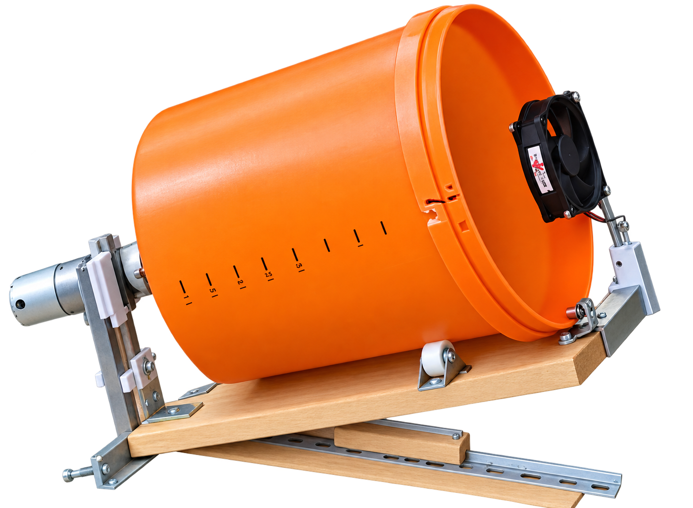

Maker Media GmbH

***

# Trommeltrockner für Kaffeesatz

### Ein langsam drehender Plastikkübel mit Lüfter macht aus nassem Kaffeesatz streufähiges Dünger-Pulver.

Nasser Kaffeesatz klumpt, schimmelt und lässt sich kaum gleichmäßig verteilen. Dieser Trommeltrockner aus Plastikkübel, Getriebemotor und Lüfter wälzt ihn so lange um, bis feines Pulver übrig bleibt.

Den vollständigen Artikel mit der Bauanleitung gibt es in der [Make-Ausgabe 7/26 ab Seite XX](https://www.heise.de/select/make/2026/7). Hier finden Sie die 3D-Druckdateien für die Motor- und Lüfterhalterung sowie für die Kupplung am Kübelboden.
